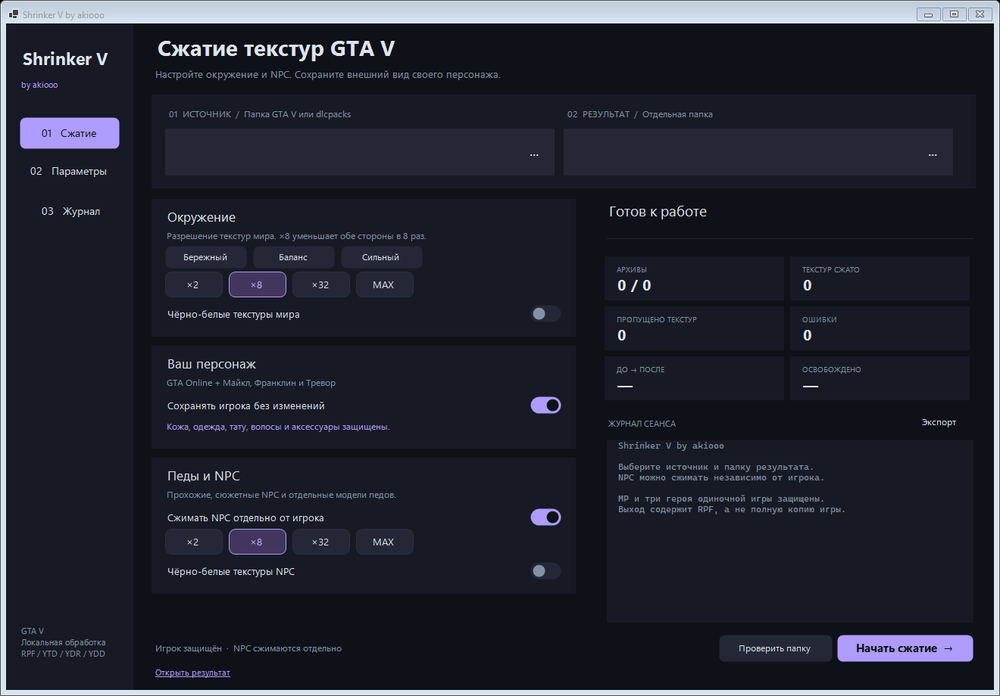

<p align="center"></p>

<h1 align="center">Shrinker V by akiooo</h1>

Пакетная обработка текстур GTA V для Windows x64. Программа обходит RPF, включая вложенные архивы, уменьшает текстуры внутри YTD, YDR, YDD и YFT и по выбору переводит цветовые текстуры в оттенки серого. Есть приложение WinForms и библиотека C# с одним и тем же обработчиком.

**Windows x64** · **GTA V** · **WinForms и C# API**

[Скачать сборку для Windows](https://github.com/akiooooo/Shrinker-V/releases/latest) · [Зависимости](DEPENDENCIES.md) · [Пример API](examples/CompressFolder.cs)



| Что обрабатывать | Что можно настроить |
| --- | --- |
| Окружение и LOD | Степень уменьшения текстур и перевод в чёрно-белый режим |
| Игрок GTA Online и сюжетные герои | Защита распознанных ресурсов кожи, одежды, тату и волос |
| Отдельные педы и NPC | Независимая настройка размера и цвета текстур |

## Готовая сборка

[Скачайте Shrinker V by akiooo для Windows x64](https://github.com/akiooooo/Shrinker-V/releases/latest/download/Shrinker-V-by-akiooo.exe) и запустите EXE. Для работы нужен .NET Framework 4.8. Библиотеки, данные для чтения и записи RPF и ресурсы дополнительных режимов уже внутри.

## Сборка из исходников

Клонируйте репозиторий и выполните команды в PowerShell на Windows x64 с .NET Framework 4.8. Скрипт использует комплект из каталога vendor.

```powershell
.\build.ps1 -Test
& ".\artifacts\Release\Shrinker V by akiooo.exe"
```

Условия использования компонентов и контрольные суммы DLL приведены в [DEPENDENCIES.md](DEPENDENCIES.md).

Выберите входную папку и отдельную папку результата. Обработка переносит дерево архивов `*.rpf`. Прочие файлы дистрибутива нужно учитывать при упаковке мода. По умолчанию включена защита распознанных ресурсов MP-игрока и сюжетных героев. Для NPC доступны отдельные параметры сжатия и цвета. Защита опирается на имена компонентов и пути в архивах. Для пользовательских моделей сервера с другими именами требуется проверка в игре.

## Вызов из C#

Добавьте ссылку на проект `src/ShrinkerV.Core/ShrinkerV.Core.csproj` или возьмите самостоятельную `ShrinkerV.Core.dll` из архива SDK на странице релиза. Библиотека включает тот же комплект зависимостей, что и EXE.

```csharp
using ShrinkerV.Core;

var options = Shrinker.CreateDefaultOptions();
options.InputFolder = inputFolder;
options.OutputFolder = outputFolder;
options.CompressionFactor = 4;
options.UseGrayscale = true;
ProcessingStats result = Shrinker.Run(options, Console.WriteLine);
```

`Run` работает синхронно. Статистика содержит число изменённых и неудачно обработанных архивов, обработанных и пропущенных текстур, ошибки и размеры в байтах. Проверяйте `ArchivesFailed`, `TexturesFailed` и `ErrorsEncountered`. Для интерфейса используйте `RunWithProgress`. Его обработчик получает сообщение, уровень, текущие счётчики, число завершённых архивов и общее количество. Обработчик может вызываться из рабочих потоков. Для отмены передайте `CancellationToken` через `options.Cancel` и обработайте `OperationCanceledException`.

В одном процессе допускается одна активная задача из-за общего состояния CodeWalker. Каждый архив обрабатывается во временной копии. После успешной обработки программа переносит результат по месту назначения. Отмена сохраняет уже завершённые архивы. Для изменения исходных RPF предусмотрен явный параметр `ProcessInPlace`. Для первой проверки используйте отдельную папку результата.

[Готовый пример консольной программы](examples/CompressFolder.cs) принимает входную и выходную папки и возвращает код ошибки для автоматизации.

## Тестирование

`build.ps1 -Test` проверяет форматы DDS, правила защиты игрока, элементы управления, обработку ошибок API и сохранность существующего результата при повреждённом входном файле.

Для интеграционных проверок передайте `-FixtureDir` с тестовым `x64a.rpf`, содержащим YTD с текстурой не менее 256 × 256. Папка должна содержать один RPF. Тест сравнит источник побайтово, откроет результат и проверит ресурсы игрока и NPC в одном вложенном архиве.

```powershell
.\build.ps1 -Test -FixtureDir .\local\fixture
```

Проверки архивов выполняются через CodeWalker. Совместимость конкретной сборки мода с интерьером казино Majestic и отображение проблемных причёсок требуют отдельной проверки в клиенте.

## Структура

| Каталог | Назначение |
| --- | --- |
| `src/ShrinkerV.Core` | Публичный API, чтение и запись RPF, правила выбора ресурсов и кодек DDS |
| `src/ShrinkerV.Studio` | Окно приложения, настройки и журнал |
| `tests/ShrinkerV.Tests` | Исполняемые регрессионные и интеграционные проверки |
| `examples` | Вызов API из отдельной программы |
| `vendor`, `licenses` | Встраиваемые библиотеки, данные и уведомления авторов |
