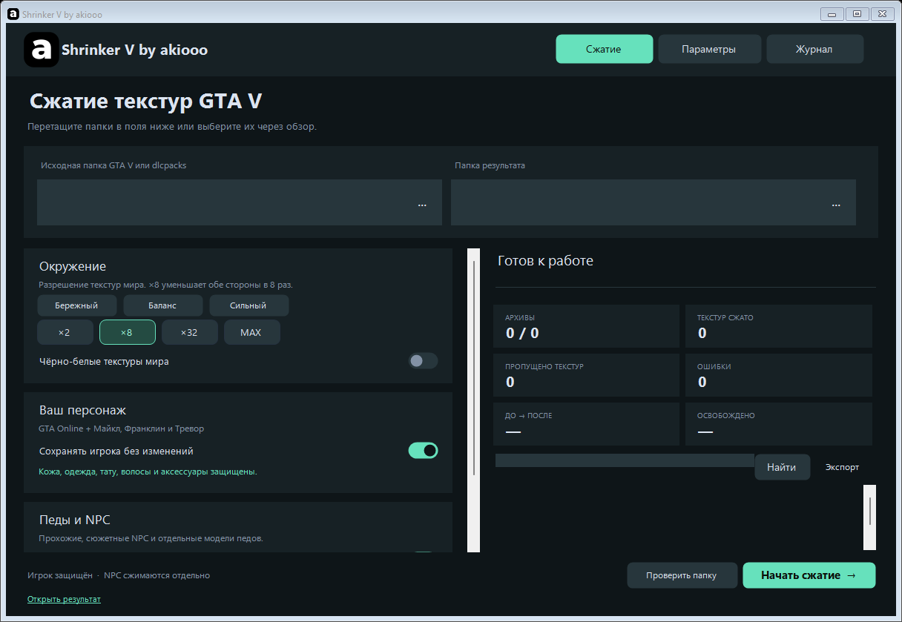

# Shrinker V by akiooo · C#

Приложение для уменьшения текстур GTA V в архивах RPF. Интерфейс, CLI, C# API и обработчики игровых форматов собраны в одном EXE. Для запуска требуется Windows x64 с .NET Framework 4.8.

**[Скачать сборку для Windows x64](https://github.com/akiooooo/Shrinker-V/releases/latest)** · [Версия с ядром на Rust](https://github.com/akiooooo/Shrinker-V-Rust)

## Обработка архивов

Выберите папку с исходными RPF и отдельную папку для результата. В интерфейсе можно настроить размер текстур, цвет и число потоков. Также доступен пакетный запуск из PowerShell.

```powershell
& '.\Shrinker V by akiooo.exe' --run 'D:\GTA-input' 'D:\GTA-output' --factor 4 --threads 4 --gray | Out-Host
```

Для цветной сборки уберите `--gray`. Защита ресурсов игрока включена по умолчанию. Архивы `common.rpf`, `update.rpf`, `update2.rpf`, а также `dlc.rpf` из `mppatchesng` и `patchday2bng` копируются целиком. Используйте исходные игровые архивы в качестве входных данных.



## Сборка и тесты

На Windows x64 установите .NET Framework 4.8 и NuGet CLI. В корне репозитория выполните:

```powershell
nuget install Microsoft.Net.Compilers.Toolset -Version 4.14.0 -ExcludeVersion -OutputDirectory tools -Source https://api.nuget.org/v3/index.json
.\build.ps1 -Test
```

Если Roslyn уже установлен, укажите папку с `csc.exe` через `-CompilerDir`. Для дополнительных интеграционных проверок передайте `-FixtureDir` с тестовым `x64a.rpf`. Готовые файлы появятся в `dist`.

## C# API и компоненты

Добавьте ссылку на собранный EXE и вызовите `ShrinkerV.Core.Shrinker.Run`. [Пример пакетной обработки](examples/CompressFolder.cs).

Обработчики форматов компилируются из исходников в `src/Formats`. Внешние CodeWalker и SharpDX DLL при запуске не нужны. Авторские уведомления и условия использования исходных компонентов находятся в [licenses](licenses). Права на встроенные игровые материалы принадлежат их правообладателям.
